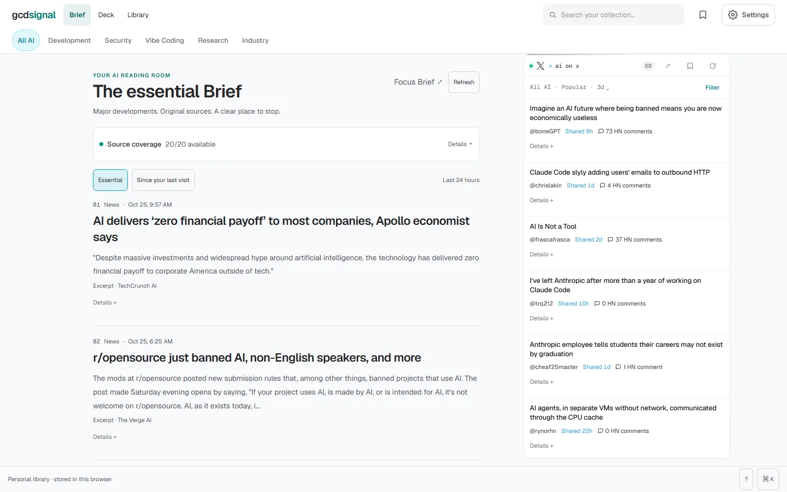

# gcd signal

**A local-first AI news reader: a daily Brief of what matters, source columns for browsing deeper, and a searchable Library that lives in your browser.**

Live at [gcdsignal.vercel.app](https://gcdsignal.vercel.app). No account, no paid AI service, no hosted database.

## Why I built this

AI news is a firehose and most readers rank it by engagement. I wanted ten stories a day chosen by transparent rules, with the original source one click away and the selection reason shown, and everything I keep stored on my own machine rather than in someone's account.

Selection uses plain rules and source evidence, not a language-model classifier. It is a best-effort reading aid, not a guarantee that every important story is covered.

**Tech:** Next.js 16, React 19, TypeScript, IndexedDB for the Library. Deployed on Vercel with a rate limit on the feed API.

## Run locally

~~~bash
npm ci
npm run dev
~~~

Open [localhost:3000](http://localhost:3000). Some upstream sources need optional credentials (see `.env.example`) or may be unavailable from your host; the coverage display reports failures instead of hiding them.

~~~bash
npm test
npm run lint
npm run build
~~~

## Docs

- [Reading guide](docs/reading-guide.md): the Brief, Deck and Library, every source and its limits, and local data and backups.
- [How selection, ranking and storage work](docs/feed-selection.md).
- [X discovery](docs/x-discovery.md): selection rules and coverage limits for the AI on X column.
- [Operation and verification](docs/operations.md): deployment, the API rate limit, security headers and the browser test suites.
